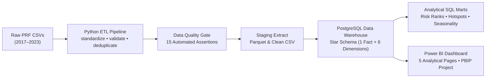
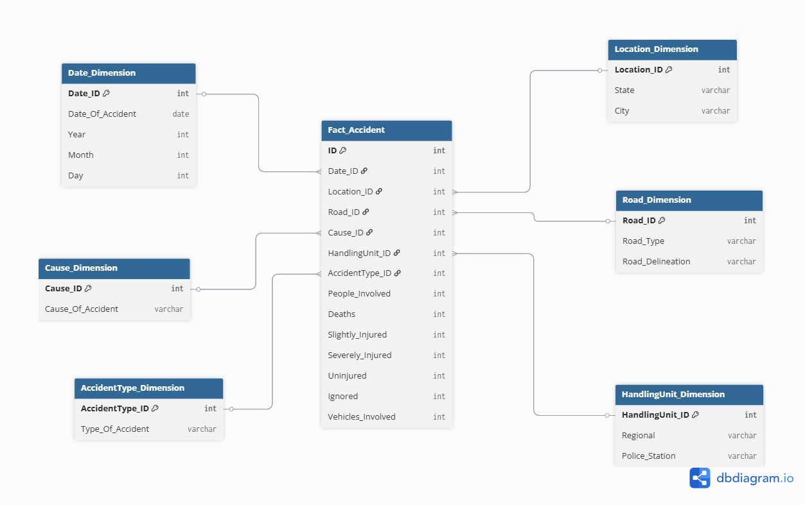
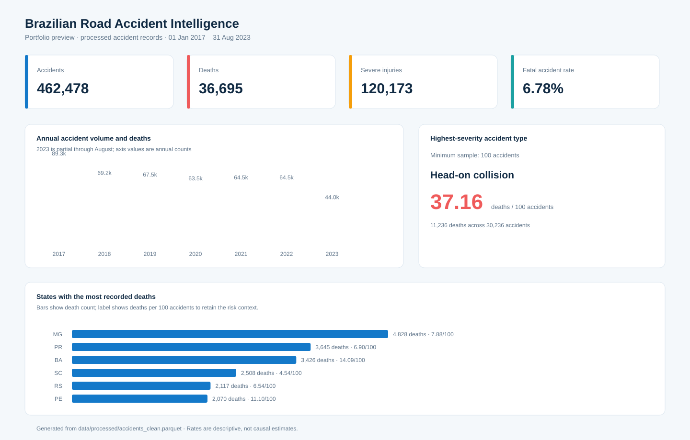

# Brazilian Road Accident Data Warehouse & Analytics Platform

> **Brazilian Federal Highway Police (PRF)** | Python · PostgreSQL · Kimball Star Schema · Power BI

[](https://www.python.org/)
[](https://www.postgresql.org/)
[](https://powerbi.microsoft.com/)
[](data/processed/quality_report.json)
[](LICENSE)

---

## Business Problem

Brazil's federal highway system spans over 73,000 kilometers of high-speed roads, serving as the backbone for freight logistics and passenger transit. Every year, tens of thousands of severe incidents occur, producing complex operational reports recorded by the **Polícia Rodoviária Federal (PRF)**.

Governmental bodies, road concessionaires, and public-safety directors face critical operational challenges:
- **Raw Log Chaos:** Source records contain millions of raw incident lines with irregular text encodings, inconsistent city naming, and mixed numeric indicators.
- **Volume vs. Lethality Bias:** High accident count alone is a misleading metric — areas with moderate volume often suffer disproportionately higher fatality rates due to severe road geometry or head-on collisions.
- **Lack of Centralized Analytics:** Stakeholders lack an integrated, drillable data platform to answer **where**, **when**, and **why** fatal traffic accidents occur.

This project delivers an **end-to-end analytics engineering platform**: from source profiling, reproducible Python ETL, Kimball star-schema data warehouse modeling in PostgreSQL, automated quality assertions, to an interactive **5-page Power BI executive dashboard**.

---

## Architecture



---

## Data Modeling

**Kimball Dimensional Modeling — Star Schema**

The warehouse is designed at a consistent atomic grain of **one row per traffic accident incident**.



### 1 Fact Table

| Table | Grain | Key Measures |
|---|---|---|
| `dw.fact_accident` | 1 row per recorded accident | `people_involved`, `deaths`, `severely_injured`, `slightly_injured`, `uninjured`, `ignored`, `vehicles_involved` |

### 6 Dimension Tables

| Dimension Table | Natural / Business Key | Key Descriptive Attributes |
|---|---|---|
| `dw.dim_date` | `date_of_accident` | `date_key`, `full_date`, `day`, `month`, `year`, `quarter`, `day_of_week` |
| `dw.dim_location` | `(state, city)` | `location_key`, `state` (UF), `city` |
| `dw.dim_road` | `(road_type, road_delineation)` | `road_key`, `road_type` (Dupla, Simples, Múltipla), `road_delineation` (Reta, Curva, Cruzamento...) |
| `dw.dim_accident_type` | `type_of_accident` | `accident_type_key`, `type_of_accident` (Colisão frontal, Saída de leito, etc.) |
| `dw.dim_cause` | `cause_of_accident` | `cause_key`, `cause_of_accident` (Lack of attention, mechanical fault, speed...) |
| `dw.dim_handling_unit` | `(regional, police_station)` | `handling_unit_key`, `regional` (PRF Superintendency), `police_station` (Delegacia) |

### Key Design Decisions
1. **Separation of Cause and Type:** In PRF reporting, "Cause" (why it happened) is strictly orthogonal to "Accident Type" (physical collision mechanism). Keeping them in dedicated dimensions prevents combinatorial explosion and Cartesian join defects.
2. **Preservation of Partial Records via `Unknown` Member:** When attributes (such as road curvature) are missing in the field, they are mapped to an explicit `'Unknown'` surrogate key instead of dropping the entire accident record. This guarantees **100% preservation of death and injury counts**.
3. **Surrogate Keys:** Integer surrogate keys (`*_key` / `*_id`) isolate the analytical warehouse from external identifier changes and optimize columnar indexing and JOIN performance.

---

## Key Business Metrics

All measures are standardized across both SQL queries and DAX formulations:

| Metric | Business Definition | DAX / SQL Formula |
|---|---|---|
| **Accidents** | Total volume of traffic collisions | `COUNTROWS(fact_accident)` |
| **Fatalities (Deaths)** | Total lives lost | `SUM(fact_accident[deaths])` |
| **Fatal Accidents** | Collisions resulting in $\ge 1$ death | `CALCULATE([Accidents], fact_accident[deaths] > 0)` |
| **Fatality Rate (%)** | Share of collisions that are lethal | `DIVIDE([Fatal Accidents], [Accidents])` |
| **Deaths per 100 Acc** | Lethality intensity index | `100 * DIVIDE([Deaths], [Accidents])` |
| **Severe Injuries** | Victims requiring intensive hospitalization | `SUM(fact_accident[severely_injured])` |
| **Severe Injury Rate (%)**| Proportion of people severely wounded | `DIVIDE(SUM([severely_injured]), SUM([people_involved]))` |

---

## ETL Pipeline & Quality Assurance

### Technology Stack
- **Python 3.10+** — `pandas`, `pyarrow`, `SQLAlchemy`, `psycopg2`
- **PostgreSQL 15+** — Star Schema warehouse storage
- **Power BI Desktop** — Multi-page Fabric PBIP analytical reporting

### Automated Data Quality Checks (15 Assertions)

The pipeline executes pre-load validations ([`src/quality.py`](src/quality.py)) and post-load SQL assertions ([`sql/04_data_quality_checks.sql`](sql/04_data_quality_checks.sql)):

| Category | Assertions | Criteria | Status |
|---|---|---|---|
| **Completeness** | 2 | Fact row count $> 400,000$; dimensions populated | **PASS** |
| **Nullability** | 7 | Foreign keys in `fact_accident` must be `NOT NULL` | **PASS** |
| **Validity** | 2 | Measures $\ge 0$ (`deaths`, `injuries`, `people`, `vehicles`) | **PASS** |
| **Uniqueness** | 1 | No duplicate natural accident incidents | **PASS** |
| **Referential Integrity** | 2 | Zero orphaned foreign keys across all 6 conformed dimensions | **PASS** |
| **Range & Coverage** | 1 | Date span covers 2017-01-01 through 2023-08-31; all 27 Brazilian states present | **PASS** |

---

## Setup & Running

### Prerequisites
- Python 3.10+
- PostgreSQL 15+ (Local or Docker)
- Microsoft Power BI Desktop (for opening the `.pbip` / `.pbix` report)

### 1. Clone & Setup Environment

```bash
# Clone the repository
git clone https://github.com/TrungPham233/Brazilian-Road-Traffic-Accidents-Data-Warehouse.git
cd Brazilian-Road-Traffic-Accidents-Data-Warehouse

# Create virtual environment and install dependencies
python -m venv .venv
source .venv/bin/activate  # On Windows: .venv\Scripts\activate
pip install -r requirements.txt
```

### 2. Prepare Source Dataset
Download the PRF Brazilian Federal Highway Accidents dataset (2017–2023) and place the CSV in:
```
data/raw/accidents_2017_to_2023_english.csv
```

### 3. Run ETL Pipeline
Execute the automated cleaning, standardization, dimension extraction, and quality audit:
```bash
python -m src.etl
```
*Outputs generated:*
- `data/processed/accidents_clean.parquet`
- `data/processed/accidents_clean.csv`
- `data/processed/quality_report.json`

### 4. Create Warehouse & Load Data
Execute the SQL scripts against your PostgreSQL database:
```bash
# 1. Create Star Schema DDL
psql -U postgres -d road_accidents_dw -f sql/01_create_warehouse.sql

# 2. Bulk load fact and dimension tables
psql -U postgres -d road_accidents_dw -f sql/02_load_warehouse.sql

# 3. Run analytical queries
psql -U postgres -d road_accidents_dw -f sql/03_analytics_queries.sql

# 4. Verify data quality assertions
psql -U postgres -d road_accidents_dw -f sql/04_data_quality_checks.sql
```

### 5. Launch BI Dashboard
Open [`powerbi.pbip`](powerbi.pbip) directly in **Power BI Desktop**.

---

## Project Structure

```
Brazilian-Road-Traffic-Accidents-Data-Warehouse/
├── data/
│   ├── raw/                            # Source CSV extracts (not tracked in Git)
│   │   └── .gitkeep
│   └── processed/                      # Staged Parquet, clean CSV & quality report
│       ├── accidents_clean.parquet
│       ├── accidents_clean.csv
│       └── quality_report.json
├── docs/                               # Documentation, architecture & specifications
│   ├── dashboard-spec.md               # Power BI 5-page specification & DAX formulas
│   ├── data-dictionary.md              # Warehouse column definitions and types
│   ├── data-profile.md                 # Statistical data profile & anomalies
│   ├── dashboard-preview.svg           # Vector preview of executive analytics
│   └── star-schema.dbml                # Database markup schema definition
├── powerbi.Report/                     # Power BI PBIP Report definition (JSON)
│   ├── definition/
│   │   ├── pages/                      # 5 analytical report page configurations
│   │   └── report.json
│   └── StaticResources/                # Custom themes & background UI canvas template
├── powerbi.SemanticModel/              # Power BI TMDL Semantic Model definition
│   └── definition/
│       ├── tables/                     # TMDL table and DAX measure files
│       └── relationships.tmdl
├── sql/
│   ├── 01_create_warehouse.sql         # PostgreSQL DDL for Star Schema
│   ├── 02_load_warehouse.sql           # Data ingestion & staging load script
│   ├── 03_analytics_queries.sql        # High-impact business analytical queries
│   └── 04_data_quality_checks.sql      # 15 automated database quality assertions
├── src/
│   ├── etl.py                          # End-to-end extraction and cleansing pipeline
│   ├── quality.py                      # Data validation and quality reporter
│   └── build_dashboard_preview.py      # Standalone SVG dashboard visualizer
├── anh_diagram.png                     # Star schema architecture visual
├── powerbi.pbip                        # Main Power BI Project file
├── powerbi.pbix                        # Packaged Power BI workbook
├── requirements.txt                    # Python environment dependencies
└── README.md
```

---

## Dataset Profile & Evidence

**Source:** Polícia Rodoviária Federal (PRF) Open Data  
**Temporal Span:** 01 Jan 2017 – 31 Aug 2023 (80 consecutive months)

| Entity / Dimension | Row Count | Analytical Granularity |
|---|---|---|
| `Fact (Accidents)` | **462,478** | Individual recorded road accident |
| `Total Fatalities` | **36,695** | Total recorded deaths |
| `Severe Injuries` | **120,173** | Critical medical emergencies |
| `Total People Involved` | **1,093,036** | Population exposed to traffic incidents |
| `Total Vehicles Involved` | **761,199** | Fleet involvement |
| `dim_date` | **2,434** | Calendar dates across 2017–2023 |
| `dim_location` | **2,131** | Unique State (UF) & City pairings across all 27 states |
| `dim_road` | **30** | Road type (Dupla/Simples) $\times$ Delineation (Reta/Curva) |
| `dim_cause` | **85** | Standardized accident root causes |
| `dim_accident_type` | **21** | Physics of collision (Head-on, rollover, pedestrian hit) |
| `dim_handling_unit` | **176** | Regional superintendencies & police stations |

### Known Source Anomalies & Handling

| Anomaly Identified | Occurrences | Engineering Resolution |
|---|---|---|
| **Diacritic Inconsistencies** | Thousands | Unicode normalization (`NFKD`) to ASCII to reconcile city and cause spellings |
| **Missing Road Attributes** | 674 rows | Mapped to explicit surrogate `Unknown` rather than dropping fact rows |
| **High Exposure vs High Risk** | Systemic | Implemented `Deaths per 100 Accidents` with sample threshold ($\ge 100$) to eliminate small-sample noise |

---

## BI Dashboard (Power BI Desktop)

**Tool:** Power BI Desktop (Power BI Project - `.pbip`)  
**Design System:** Modern Dark-Sidebar UI Layout (`1280x720`) with dedicated `pageNavigator`, top KPI cards, and cross-visual filtering.



### 5 Analytical Pages

| Page | Target Stakeholder | Core Business Questions Answered | Key Visuals & Interactions |
|---|---|---|---|
| **1. Executive Overview** | Road Safety Leadership | What is the overall macro trend in accidents and fatalities? Which accident types have the highest lethality? | • 4 Top KPI Cards<br>• Combo Chart: Volume vs Deaths (2017–2023)<br>• Top States by Fatalities<br>• Lethality index by collision type |
| **2. Geographic Hotspots** | Regional Patrol Commanders | Which states, cities, and police jurisdictions account for the most severe clusters? | • Fatalities by State (UF)<br>• Top 10 lethal municipal highway corridors<br>• PRF Regional Unit workload distribution<br>• Police Station severity matrix |
| **3. Causes & Severity** | Safety Policy Analysts | What driving behaviors cause the most deaths vs. the highest incident volume? | • Top causes ranked by fatalities (Lack of attention, lane invasion)<br>• Fatalities by accident typology<br>• Cause volume vs severity matrix |
| **4. Road & Infrastructure** | Highway Engineers & Regulators | How does highway geometry (divided vs single lane, curved vs straight) impact survival? | • Accidents by Road Type (Dupla vs Simples)<br>• Lethality index across Road Delineations<br>• Infrastructure risk cross-matrix |
| **5. Time & Seasonality** | Tactical Scheduling Planners | How does accident risk fluctuate by year, calendar month, and day of month? | • 7-year multi-line monthly seasonality tracker<br>• High-risk month detection (December travel surge)<br>• Day of month volume distribution |

> **Navigation Tip in Power BI Desktop:** When in authoring/edit mode, hold **`Ctrl` + Click** on the left sidebar buttons to navigate between pages, or single-click the page tabs at the bottom.

---

## Future Improvements

- **Apache Airflow Orchestration:** Automated daily/monthly ingestion DAGs with Slack alerting on pipeline failure.
- **dbt Core Transformation:** Implementing staging, intermediate, and dimensional models with automated dbt tests and docs.
- **Cloud Migration:** Storing raw data in AWS S3 / Google Cloud Storage, staging into Snowflake / BigQuery, and serving reports via Power BI Service.
- **Predictive ML Modeling:** Training classification models (XGBoost/LightGBM) to score accident severity based on weather, road type, and time of day.

---

## License

This project is licensed under the [MIT License](LICENSE).
